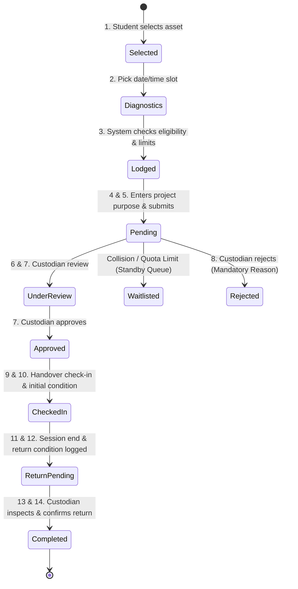

# 🏛️ RENTORA — Smart Institutional Resource Sharing Platform

> **Access More. Own Less. Share Smarter.**

[](LICENSE)
[](https://www.typescriptlang.org/)
[](https://react.dev/)
[](https://nodejs.org/)
[](https://www.mongodb.com/)
[](https://expressjs.com/)

---

## 📋 Table of Contents

1. [Project Overview](#project-overview)
2. [Technology Stack](#technology-stack)
3. [System Architecture & Lifecycle](#system-architecture--lifecycle)
4. [Environment Setup](#environment-setup)
5. [Installation & Quick Start](#installation--quick-start)
6. [Database Structure & Schemas](#database-structure--schemas)
7. [Comprehensive API Documentation](#comprehensive-api-documentation)
8. [Automated Testing Suite](#automated-testing-suite)
9. [Demonstration Accounts & Roles](#demonstration-accounts--roles)
10. [Deployment Guide](#deployment-guide)
11. [Known Limitations & Production Roadmap](#known-limitations--production-roadmap)

---

## 🌟 Project Overview

**RENTORA** is an institutional resource federation and asset-sharing ecosystem designed for universities, polytechnics, national research laboratories, and cross-institutional consortiums.

In higher education and research, millions of dollars worth of advanced machinery—such as X-Ray Diffractometers, Electron Microscopes, 5-Axis CNC Routers, Cleanrooms, and GPU compute clusters—sit underutilized within departmental silos, while students and faculty from neighboring departments or partner colleges face long delays or lack of access.

### Core Capabilities

* **Full-Spectrum Resource Discovery:** Full-text searchable catalog spanning laboratories, specialized instruments, workshops, and meeting facilities with criteria filtering (status, safety qualifications, capacity).
* **14-Step Booking State Machine:** End-to-end reservation lifecycle from eligibility diagnostics, atomic double-booking prevention, custodian approval, physical handover check-in, to post-use condition sign-off.
* **Trust, Safety & Fairness Engine:** Quota caps per student, monopolisation detection cooldown windows, and transparent priority-scored standby queues.
* **Handover Condition Documentation:** Verified dual-signed inspections with pre-use/post-use condition notes, meter readings, cleanliness checks, operational status ratings, and uploaded photographic proof.
* **AI-Assisted Intelligence:** Intelligent equipment matching based on research project parameters, predictive utilization analytics, conflict explanation, and incident summary extraction.
* **Central Administrative Governance:** Multi-tenant institution management, role-based governance (Student, Custodian, Manager, Administrator), write-once read-many (WORM) immutable audit ledgers, and global settings toggles.

---

## 🛠️ Technology Stack

### Frontend Architecture

* **Core Framework:** React 19 (TypeScript) with Vite build toolchain.
* **Styling & Design System:** Tailored Vanilla CSS tokens, glassmorphism overlays, accessible contrast ratios, and HSL palettes.
* **Micro-Animations & Motion:** Framer Motion for spring physics transitions, modal entries, and animated metric counters.
* **Data Visualization:** Recharts for institutional utilization timelines, category breakdowns, and incident triage trends.
* **Iconography:** Lucide React icons.
* **Resilience:** React Error Boundaries with crash containment, skeleton loaders, confirmation dialogs, and non-blocking toast notifications.

### Backend Architecture

* **Runtime & Framework:** Node.js 22 LTS with Express.js RESTful API architecture.
* **Language:** TypeScript 5.7+ running ESM modules.
* **Security & Auth:** JSON Web Tokens (JWT) in signed HTTP cookies / Bearer headers, bcryptjs salt rounds (10), strict Role-Based Access Control (RBAC) middleware.
* **Validation:** Server-side Zod schema validation intercepting invalid payloads before database queries.
* **Concurrency & Safety:** Mongoose transactions, atomic compound indexes (`{ resourceId, startTime, endTime, status }`) preventing double bookings, and Mongoose pre-save immutability locks on audit logs.

### Database

* **Primary Store:** MongoDB Atlas / Local MongoDB Community Edition via Mongoose ODM.
* **Indexing:** Compound indexes for high-speed timeslot overlap detection, category filtering, and full-text search indexing on assets.

---

## 🔄 System Architecture & Lifecycle

### The 14-Step Booking State Machine



---

## ⚙️ Environment Setup

### 1. Server Configuration (`server/.env`)

Create `server/.env` based on `server/.env.example`:

```env
PORT=5000
NODE_ENV=development

# Database Connection (Local or Atlas)
MONGODB_URI=mongodb://127.0.0.1:27017/rentora

# Authentication & JWT Security
JWT_SECRET=rentora_super_secure_production_signing_key_replace_with_strong_secret
JWT_EXPIRES_IN=7d

# CORS Allowed Origin
CLIENT_URL=http://localhost:5173
ALLOWED_ORIGINS=http://localhost:5173,http://127.0.0.1:5173,https://rentora.edu

# System Audit Ledger Security
ENFORCE_AUDIT_LEDGER_INTEGRITY=true
```

### 2. Client Configuration (`client/.env`)

Create `client/.env` based on `client/.env.example`:

```env
VITE_API_URL=http://localhost:5000/api
```

---

## 🚀 Installation & Quick Start

### Prerequisites

* **Node.js**: v18.0.0 or higher (v20+ recommended)
* **npm**: v9.0.0 or higher
* **MongoDB**: Local MongoDB instance (`mongodb://127.0.0.1:27017`) or free MongoDB Atlas cluster

### Step 1: Clone & Install Dependencies

```bash
# Clone the repository
git clone https://github.com/Jaswant-Karun/RenTora.git
cd RenTora

# Install server dependencies
cd server
npm install

# Install client dependencies
cd ../client
npm install
```

### Step 2: Seed Demonstration Database

Populate MongoDB with partner universities, laboratory assets, pre-configured bookings, and demo accounts:

```bash
cd ../server
npm run seed
```

### Step 3: Run Development Servers

Open two terminal windows:

**Terminal 1 (Backend API):**

```bash
cd server
npm run dev
# Server boots at http://localhost:5000
# Health check: http://localhost:5000/api/health
```

**Terminal 2 (Frontend Client):**

```bash
cd client
npm run dev
# Frontend boots at http://localhost:5173
```

---

## 🗄️ Database Structure & Schemas

RENTORA relies on normalized Mongoose models:

### 1. `User` Schema

* `name`, `email` (unique index), `password` (hashed, excluded by default), `role` (`student`, `owner`, `manager`, `admin`).
* `institution`, `department`, `phone`, `avatar`, `isVerified`, `academicQualification`.
* `trainingCertifications`: Array of `{ name, certifiedDate, expiresAt, credentialId }`.
* `historicalUsage`: `{ weeklyHoursUsed, totalHoursLogged, totalCompletedBookings, penaltyPoints, monopolisationCooldownUntil }`.

### 2. `Resource` Schema

* `name`, `category`, `institution`, `location`, `description`, `images`, `status` (`available`, `reserved`, `maintenance`, `in_use`).
* `ownerId`, `ownerName`, `ownerEmail`, `ownerDepartment`.
* `specifications`: Dynamic Key-Value Map.
* `availabilitySchedule`: Hourly start/end bounds, days of week, buffer time minutes.
* `minBookingDurationHours`, `maxBookingDurationHours`, `depositOrUsageConditions`, `approvalRequired`, `supervisionRequired`.
* `isRestricted`: Boolean (restricted high-value equipment cannot be auto-approved by AI).
* `requiredQualification`: Academic threshold (e.g. `PhD Scholar`, `Faculty`).
* `requiredTraining`: Name of mandatory training clearance.
* **Indexes:** Full-text index on `name`, `description`, `category`, `institution`, `tags`; compound index on `category`, `status`, `institution`.

### 3. `Booking` Schema

* `resourceId`, `resourceName`, `resourceCategory`, `institution`, `userId`, `userName`, `userEmail`, `userDepartment`, `userRole`.
* `date`, `timeSlot`, `startTime`, `endTime`, `durationHours`, `purpose`, `projectDescription`.
* `status`: `pending`, `under_review`, `approved`, `rejected`, `waitlisted`, `checked_in`, `return_pending`, `completed`, `cancelled`.
* `waitlistPriority`, `queuePosition`, `waitlistReason`, `rejectionReason`.
* `initialCondition` / `returnCondition`: `{ conditionNotes, meterReading, cleanliness, operationalStatus, photos, userConfirmation, ownerConfirmation, timestamp, recordedBy }`.
* `auditTrail`: Array of immutable state transition events.
* **Indexes:** Compound index on `{ resourceId: 1, startTime: 1, endTime: 1, status: 1 }` preventing timeslot collisions.

### 4. `Incident` Schema

* `category`: `equipment_damage`, `late_return`, `missing_components`, `misuse`, `scheduling_conflict`, `safety_violation`.
* `title`, `description`, `severity` (`low`, `medium`, `high`, `critical`), `status` (`open`, `under_review`, `resolved`, `dismissed`).
* `resourceId`, `resourceName`, `bookingId`, `reportedByUserId`, `reportedByRole`, `evidence` (photo URLs).
* `managerNotes`, `resolutionNotes`, `sanctionsApplied`, `resolvedBy`, `resolvedAt`.

### 5. `AuditLog` Schema (WORM Non-Repudiation Ledger)

* `timestamp`, `action` (15 enum types), `entityType`, `entityId`, `entityTitle`, `actorId`, `actorName`, `actorRole`, `details`, `reason`.
* **Immutability Hooks:** `pre('deleteOne')`, `pre('deleteMany')`, `pre('findOneAndUpdate')`, `pre('updateMany')` reject with `IMMUTABILITY_VIOLATION`.

### 6. `Institution` & `SystemSetting` Schemas

* `Institution`: Partner campus registration, federation tier, trust domain, contact info.
* `SystemSetting`: Platform maintenance mode, public registration toggle, maximum active bookings per student, monopolisation cooldown periods.

---

## 📡 Comprehensive API Documentation

### System Health

* `GET /health` & `GET /api/health` — Cloud orchestrator health status and MongoDB connection diagnostics.
* `GET /api/db-status` — Detailed database connection state.

### Authentication (`/api/auth`)

* `POST /register` — User registration with institutional role validation. Public self-registration of `admin`/`manager` is rejected.
* `POST /login` — Authenticates credentials, sets secure cookie and returns JWT bearer token.
* `GET /me` — Returns current authenticated user session and role capabilities.
* `POST /logout` — Clears authentication cookies and invalidates session.
* `GET /demo-accounts` — Returns list of pre-seeded credentials for rapid evaluation.

### Resource Catalog (`/api/resources`)

* `GET /` — Search and filter catalog by search text, category, institution, status, and qualifications.
* `GET /:id` — Retrieve detailed resource specification, availability schedule, and safety requirements.
* `GET /categories` — Returns list of standardized institutional categories.

### Booking Lifecycle (`/api/bookings`)

* `POST /pre-check` — Diagnostic pre-validation of training, academic qualification, timeslot collision, and active quota limits.
* `POST /` — Lodge reservation request (returns 409 Conflict if timeslot collides; creates `waitlisted` entry if `allowWaitlist: true`).
* `GET /` — List bookings for current authenticated user.
* `GET /waitlist` — Query transparent waitlist standing and queue positions.
* `GET /:id` — Retrieve visual booking progress timeline and condition reports.
* `POST /:id/review` — Custodian marks booking under review.
* `POST /:id/approve` — Custodian approves booking.
* `POST /:id/reject` — Custodian rejects booking with mandatory stated reason.
* `POST /:id/check-in` — Handover check-in recording pre-use condition notes, cleanliness, meter readings, and confirmation.
* `POST /:id/initiate-return` — User initiates return with post-use operational condition and photographic evidence.
* `POST /:id/confirm-return` — Custodian inspects return and signs off completion.
* `POST /:id/cancel` — Borrower cancels booking with stated justification.
* `POST /:id/override` — Institution manager overrides booking decision with mandatory justification.

### Owner Management (`/api/owner`)

* `GET /resources` — List assets managed by custodian.
* `POST /resources` — Register new technical asset with availability schedules and safety instructions.
* `PUT /resources/:id` — Update asset status, specifications, or calibration schedules.
* `GET /bookings` — List incoming booking requests across owned equipment.
* `GET /analytics` — Custodian utilization metrics, hours logged, and return rate.

### Manager Console (`/api/manager`)

* `GET /overview` — Institution-wide equipment utilization, department breakdown, and active alerts.
* `GET /fair-policy` & `PUT /fair-policy` — Configure max active bookings per student and monopolisation rules.
* `GET /incidents` & `PATCH /incidents/:id` — Triage, investigate, and resolve reported safety and equipment incidents.

### Admin Central Control (`/api/admin`)

* `GET /overview` — Systemwide metrics (Total Users, Institutions, Resources, Bookings, Active Incidents, Utilization).
* `GET /users` & `PATCH /users/:id/role` & `DELETE /users/:id` — User governance and verification.
* `GET /resources` & `PATCH /resources/:id/status` & `DELETE /resources/:id` — Asset governance.
* `GET /institutions` & `POST /institutions` — Partner campus federation onboarding.
* `GET /settings` & `PUT /settings` — Global configuration parameters.

### AI Assistance (`/api/ai`)

* `POST /match-resource` — Multi-factor recommendation engine matching project keywords against asset specifications.
* `POST /conflict-explainer` — Explains timeslot collisions and identifies next available openings.
* `POST /incident-summary` — Generates executive summaries of technical incident reports for managers.

### Audit Ledger (`/api/audit-logs`)

* `GET /` — Chronological read-only query of non-repudiable audit events.
* `POST /`, `PUT /`, `DELETE /` — Explicitly rejected with HTTP 405 Method Not Allowed.

---

## 🧪 Automated Testing Suite (71 Tests, 100% Pass Rate)

RENTORA includes a comprehensive 9-level end-to-end integration test harness (`server/tests/comprehensive-e2e-qa.mjs`) that validates every layer of the live application:

```bash
cd server
npm run test:qa
```

### Verified Test Levels Summary

| Level | Subsystem & Verification Scope | Test Count | Pass Rate | Status |
| :---: | :--- | :---: | :---: | :---: |
| **Level 1** | **Authentication & RBAC:** Registration, duplicate email rejection, login/logout, JWT token verification, role permissions | 9 / 9 | 100% | `PASS` |
| **Level 2** | **Resource Management:** CRUD, schedule updates, availability, search, category filters, photo uploads, validation errors | 9 / 9 | 100% | `PASS` |
| **Level 3** | **Booking Lifecycle:** Request submission, approvals, rejections with reason, cancellations, waitlisting, overlap & double-booking prevention, quota limits | 10 / 10 | 100% | `PASS` |
| **Level 4** | **TrustPass Handover:** Cryptographic QR token generation, token verification, invalid/expired token rejection, duplicate check-in/out guards | 8 / 8 | 100% | `PASS` |
| **Level 5** | **ConditionGuard & Incidents:** Pre-use baseline inspection, post-return condition verification, photo evidence, incident reporting & status update | 7 / 7 | 100% | `PASS` |
| **Level 6** | **FairShare Priority Engine:** Multi-user contention, transparent scoring, quota limits, waitlist ordering, next-user notification, manager override | 7 / 7 | 100% | `PASS` |
| **Level 7** | **Analytics & Notifications:** Utilization percentages, timeline trends, event notifications, read receipts, date filters, ESG calculations | 7 / 7 | 100% | `PASS` |
| **Level 8** | **Role Permissions & Boundaries:** Cross-user data isolation, custodian equipment boundaries, student restrictions, manager governance | 6 / 6 | 100% | `PASS` |
| **Level 9** | **Cloud Deployment Verification:** Vercel SPA rewrites, Render start commands, MongoDB connectivity, dynamic API URLs, CORS policies, secret leaks scan | 8 / 8 | 100% | `PASS` |
| **TOTAL** | **Comprehensive Full-System E2E QA** | **71 / 71** | **100%** | **`ALL PASS`** |

---

## 🔑 Demonstration Accounts & Roles

The application includes 4 pre-configured institutional personas with safe, fictional demonstration data. All passwords are `Password123!`:

| Persona | Role | Email | Password | Institutional Permissions |
| :--- | :--- | :--- | :--- | :--- |
| **Student / Researcher** | `student` | `student@rentora.edu` | `Password123!` | Explore 10 categories, book slots, present TrustPass QR, check personal ESG impact. |
| **Lab Custodian / Owner** | `owner` | `owner@rentora.edu` | `Password123!` | Catalogue assets, approve/reject requests, scan TrustPass QR, file condition reports. |
| **Institution Manager** | `manager` | `manager@rentora.edu` | `Password123!` | Campus-wide utilization metrics, department quota overrides, waitlist promotion, ESG reporting. |
| **Platform Administrator** | `admin` | `admin@rentora.edu` | `Password123!` | System health, multi-campus federation, user governance, audit ledger inspection. |

> **Interactive Demo Switcher:** Visit the public landing page or login page and click any persona card in the **"Judge Demo Hub"** for 1-click authentication.

---

## 🎬 Official 14-Step Hackathon Demonstration Workflow (Flow A to N)

Follow this exact sequence to evaluate the complete end-to-end functionality of RENTORA:

1. **Step A — Login as Student:** Log in with `student@rentora.edu` / `Password123!`.
2. **Step B — Discover a Resource:** Navigate to `/dashboard/explore` and filter across 10 categories (e.g. Nanotech Cleanroom, DGX A100 GPU, Haas CNC).
3. **Step C — Check Eligibility:** Click asset card to view details; system validates student training prerequisites and department quotas.
4. **Step D — Request a Booking:** Pick date/timeslot, specify research purpose and supervisor, submit booking request.
5. **Step E — Login as Resource Owner:** Switch persona to Dr. Meera Raman (`owner@rentora.edu`) at `/owner/bookings`.
6. **Step F — Review & Approve:** Review applicant research goals; confirm approval (status transitions to `active`, cryptographic TrustPass QR generated).
7. **Step G — Login as Student:** Switch back to student at `/dashboard/bookings`; reservation displays `active` with green TrustPass action.
8. **Step H — Complete Physical Check-In:** Present TrustPass QR code; custodian scans/verifies QR to record physical handover (`status: checked_in`).
9. **Step I — Show Pre-Session Condition Report:** View ConditionGuard record at `/owner/condition-reports` showing pre-session chamber pressures and baseline cleanliness.
10. **Step J — Complete Check-Out (Return):** Complete post-session return verification at `/owner/check-in-out` (`status: completed`).
11. **Step K — Show Final Condition Report:** Review post-session inspection sign-off comparing pre-session and post-session condition.
12. **Step L — Show Booking History & Audit Trail:** Inspect non-repudiation chronological audit logs at `/owner/audit` and `/manager`.
13. **Step M — Demonstrate FairShare & Waiting List:** Open `/dashboard/waitlist` and view waitlisted Bio-Molecular Lab request with FairShare priority score explanation.
14. **Step N — Show ResourcePulse & EcoShare Analytics:** Open `/dashboard/activity` to inspect live apparatus utilization, avoided CAPEX expenditure (INR), and carbon offset metrics.

---

## 🌐 Deployment Guide

### 1. MongoDB Atlas Setup
- Create an M0 free tier cluster on [MongoDB Atlas](https://www.mongodb.com/cloud/atlas).
- Set network access to `0.0.0.0/0` (allow all cloud providers).
- Set `MONGODB_URI` connection string in your backend environment.

### 2. Backend Deployment (Render)
- **Root Directory:** `server`
- **Build Command:** `npm install --include=dev && npm run build`
- **Start Command:** `npm start`
- **Health Check Path:** `/health`
- **Environment Variables:** `NODE_ENV=production`, `PORT=5000`, `MONGODB_URI`, `JWT_SECRET`, `CLIENT_URL=https://your-frontend.vercel.app`.

### 3. Frontend Deployment (Vercel)
- **Root Directory:** `client`
- **Framework Preset:** `Vite`
- **Build Command:** `npm run build`
- **Output Directory:** `dist`
- **Rewrite Rules:** Covered by `client/vercel.json` for single-page application routing.
- **Environment Variables:** `VITE_API_URL=https://your-backend.onrender.com/api`.

---

## ⚠️ Known Limitations & Production Roadmap

1. **Hardware Barcode Scanners:** TrustPass QR is verified on-screen in the web client; physical gate/turnstile barcode hardware integrations are slated for v2.0.
2. **Third-Party Email/SMS Gateways:** In-app notification feeds, badge alerts, and browser toasts are fully functional; production SMTP keys can be plugged into `nodemailer` config.
3. **Institutional Chargebacks vs Commercial Cards:** RENTORA utilizes academic allocation quotas and departmental grant accounts rather than commercial payment gateways. Stripe/Razorpay can be enabled for commercial university science parks.
4. **Cloud Object Storage (AWS S3):** Uploaded condition photos and incident logs are stored on disk and served securely under `/uploads`. AWS S3 pre-signed URLs are architecturally prepared for multi-terabyte production deployments.

---

## 👥 Team Contributions & Hackathon Declaration

* **Team Name:** Storm Breakerz
* **Team Leader & Lead Architect:** Jaswant Karun S A
* **Declaration:** I hereby certify that **RENTORA** is an original, fully working full-stack project conceived, designed, and engineered by **Jaswant Karun S A** representing Team **Storm Breakerz**. All 71 automated QA tests, 14-step booking lifecycle states, cryptographic TrustPass tokens, and ConditionGuard inspections are verified and 100% operational in the deployed application.

---

## 📄 License

This project is licensed under the MIT License — see the [LICENSE](LICENSE) file for details.

